<picture>
  <source media="(prefers-color-scheme: dark)" srcset="./docs/img/header-dark.svg">
  
</picture>

# github-profile-kit

**An animated, living GitHub profile from one `profile.toml`.** Built for people, for coding agents (Claude Code, Codex, Cursor) and for autonomous agents (OpenClaw, Hermes Agent) that want a profile of their own.

<picture>
  <source media="(prefers-color-scheme: dark)" srcset="./docs/img/skyline-berlin-dark.svg">
  
</picture>

- **One look, not a widget collage.** Every graphic shares one design language, in light and dark mode.
- **It lives.** The skyline follows real sunrise, sunset and weather in your city. Seasons switch on by themselves.
- **Visitors can play.** Anyone can open an issue `light: purple` and your skyline glows purple, with their handle next to it.
- **Live numbers.** Contribution stats (including private ones, if you allow it) and live star counts of the repos you recommend.
- **No third-party server.** Everything runs as a GitHub Action in your own repository. No rate-limited public instances, no tokens to hand out.
- **No dependencies.** Python 3.11 standard library. Nothing to install.

## Get started

### You, by hand

1. Click **Use this template** and name the new repository exactly like your GitHub login (that is the repository GitHub shows on your profile). Make it public.
2. Open **Actions**, enable workflows if GitHub asks, and run **profile** once (it also runs on every push and every 30 minutes). The first run drafts `profile.toml` from your public GitHub data and builds the profile.
3. Edit `profile.toml` in the browser. Every save rebuilds the profile. Every key is listed in the [config reference](docs/reference-config.md) and used in [`profilekit/example.toml`](profilekit/example.toml).

Locally: `python3 -m profilekit preview` renders everything into `preview.html`.

### Your coding agent

Paste this into Claude Code, Codex or any agent with `gh` access:

```text
Create my GitHub profile with https://github.com/onetechgroupll/github-profile-kit.
Follow skills/github-profile/SKILL.md from that repository. Ask me before you publish anything.
```

The repository ships the procedure as an [Agent Skill](skills/github-profile/SKILL.md) (also linked under `.claude/skills/` and `.agents/skills/`), an [`AGENTS.md`](AGENTS.md), a JSON Schema and a CLI where every command speaks `--json` and returns clean exit codes.

### An autonomous agent with its own GitHub account

Install the skill like any other [agentskills.io](https://agentskills.io) skill, for example by copying `skills/github-profile/` into your agent's skills folder (Hermes Agent: `~/.hermes/skills/`, OpenClaw: its workspace `skills/`). The agent then runs the same procedure for itself: the words describe what it does, the city is where it runs, the terminal lists its tools.

## What you can turn on

| Section | Config | Live? |
|---|---|---|
| Header with rotating words and an animated network | `[profile]`, `[hub]` | |
| Contact buttons and status pills | `[[links]]`, `[status]` | |
| Up to four focus cards with animated visuals | `[[focus]]` | |
| Organisation card | `[org]` | |
| Typed terminal session (`whoami`, `--help`, `top`, principles) | `[terminal]` | |
| Recommended repositories | `[[recommend]]` | stars, language |
| Contribution stats and the "settle" calendar | `[contributions]` | yes |
| Living skyline, procedural or hand-drawn preset | `[city]` | time of day, weather, season |
| Light-up game for visitors | `[lightup]` | yes |

<picture>
  <source media="(prefers-color-scheme: dark)" srcset="./docs/img/focus-dark.svg">
  
</picture>

<picture>
  <source media="(prefers-color-scheme: dark)" srcset="./docs/img/terminal-dark.svg">
  
</picture>

<picture>
  <source media="(prefers-color-scheme: dark)" srcset="./docs/img/settle-dark.svg">
  
</picture>

### Your city

The **generic** preset builds a skyline from your city's name (stable between builds) and the landmarks you pick: `tower`, `bridge`, `spire`, `wheel`, `dome`. A rooftop sign carries up to three letters. Rivers can carry `boats`, a `duck` or a `crocodile`.

<picture>
  <source media="(prefers-color-scheme: dark)" srcset="./docs/img/skyline-slate-dark.svg">
  
</picture>

At night the windows light up, stars come out and the seasons decorate the river bank. Here: Hamburg in Advent, with a rooftop sign, a flag and a crocodile that has no business being in the Elbe.

<picture>
  <source media="(prefers-color-scheme: dark)" srcset="./docs/img/skyline-hamburg-dark.svg">
  
</picture>

Want your real city, hand-drawn? A city is one `layer_<city>` function in `profilekit/skyline.py`. [Here is how](docs/howto-add-a-hand-drawn-city.md); pull requests are welcome.

## Examples

[`profilekit/example.toml`](profilekit/example.toml) switches everything on. [`examples/minimal.toml`](examples/minimal.toml) is the smallest useful profile. [`examples/agent.toml`](examples/agent.toml) is a profile for an autonomous agent.

## Documentation

New here? The [tutorial](docs/tutorial-your-first-profile.md) gets you from zero to a live profile in about ten minutes.

| Learn | Do | Look up | Understand |
|---|---|---|---|
| [Your first living profile](docs/tutorial-your-first-profile.md) | [Let an agent build it](docs/howto-let-an-agent-build-your-profile.md) · [Design your skyline](docs/howto-design-your-skyline.md) · [Live data and light-up](docs/howto-turn-on-live-data-and-light-up.md) · [Add a hand-drawn city](docs/howto-add-a-hand-drawn-city.md) | [profile.toml](docs/reference-config.md) · [CLI](docs/reference-cli.md) · [Workflows](docs/reference-workflows.md) | [How the kit works](docs/explanation-how-it-works.md) |

## Commands

```bash
python3 -m profilekit init --from-github --handle <login>   # draft profile.toml
python3 -m profilekit validate                              # check it
python3 -m profilekit preview                               # offline build + preview.html
python3 -m profilekit build                                 # full build; GITHUB_TOKEN enables live data
python3 -m profilekit doctor                                # environment and repository checks
python3 -m profilekit schema                                # JSON Schema
```

Add `--json` before the command for machine-readable output.

## How it works

`profile` workflow (every 30 minutes and on every push): builds static graphics into `assets/` and commits them with the README, then publishes live graphics from `dist/` to the `output` branch. The README points at that branch, so the live parts refresh without new commits on `main`. `lightup` workflow: validates an issue title against a fixed colour list, stores it in `state/lightup.json`, triggers a rebuild and closes the issue.

## Credits

Design: the kit's own design language (themes `ink` and `slate`). Fonts: [Inter](https://rsms.me/inter/) and [JetBrains Mono](https://www.jetbrains.com/lp/mono/), both SIL OFL. Weather: [Open-Meteo](https://open-meteo.com). Code: MIT.
